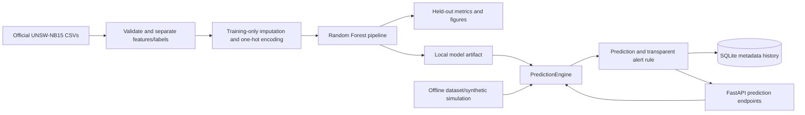
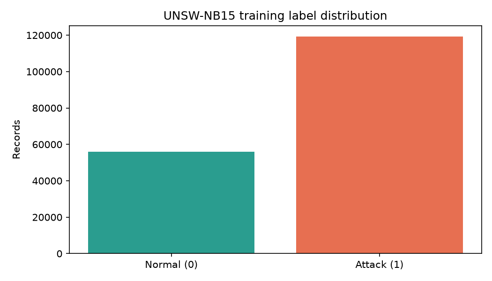
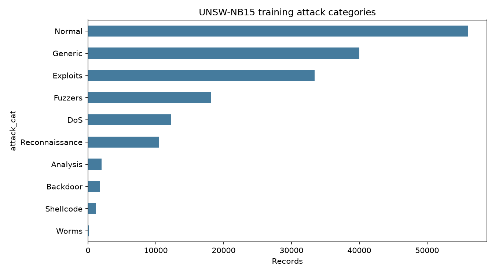
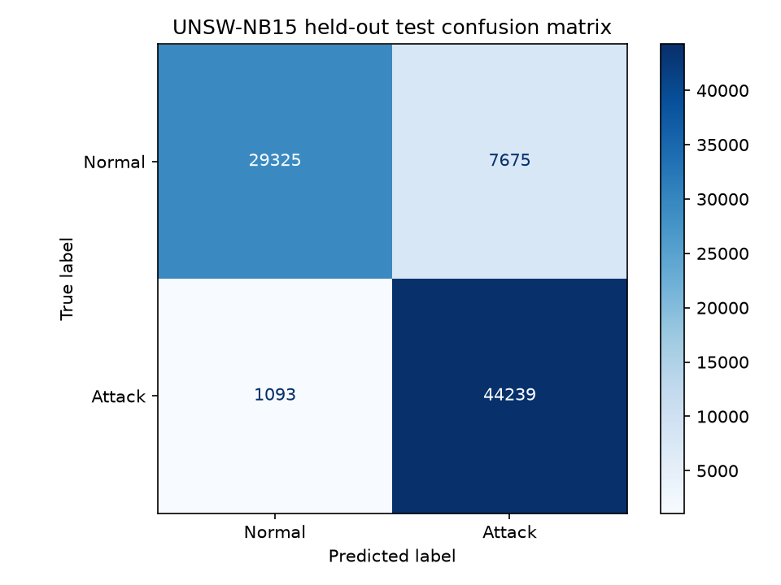
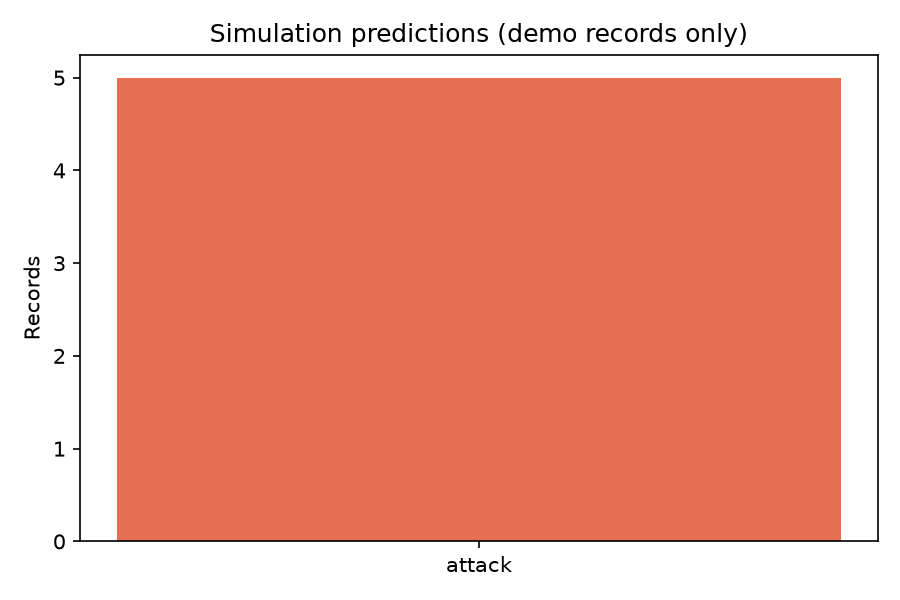
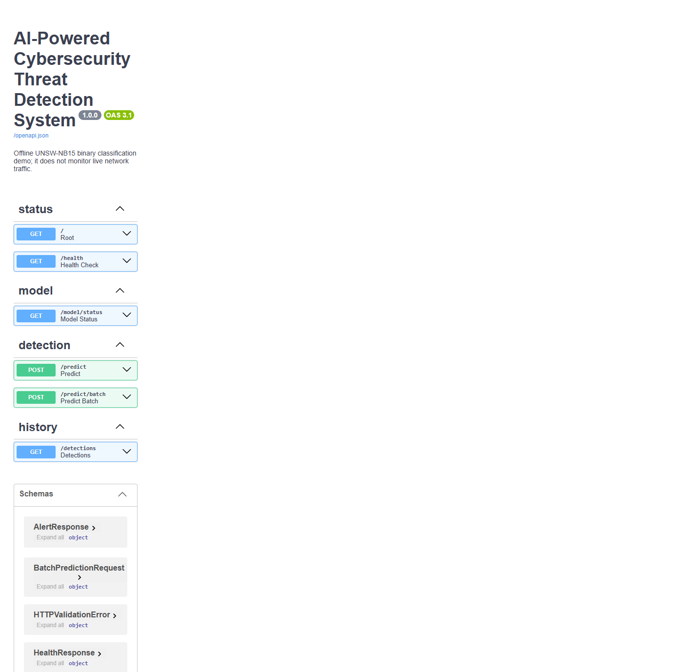
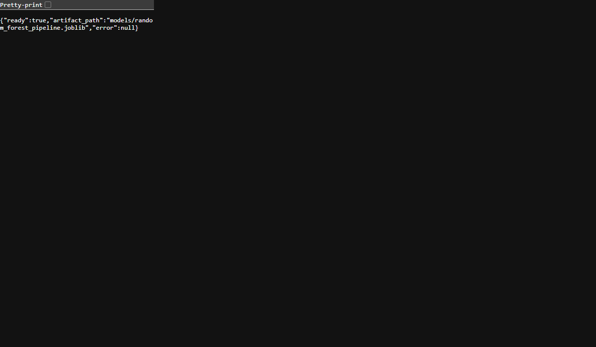

# AI-Powered Cybersecurity Threat Detection System

An educational, offline network-intrusion classification project built around the official UNSW-NB15 training/testing split. It validates structured flow records, fits preprocessing and a Random Forest on training data, evaluates once on the separate test set, and exposes predictions and demo alerts through FastAPI.

> **Scope:** this is a research/demo classifier, not a production security product. It does not capture packets, monitor a live network, or establish that a real-world host is compromised. Train and evaluate before using inference; no model or performance score is included unless it was actually generated.

## Problem and objectives

Network intrusion detection helps defenders sort high-volume connection records and prioritize suspicious activity. This project demonstrates supervised binary classification: `label=0` means normal and `label=1` means attack in the supplied dataset. It aims to make the complete data-to-prediction workflow reproducible and understandable, not replace analysts or a security operations center.

## Features

- Validates the actual CSV schema, labels, missing values, duplicate rows, and class counts.
- Preserves the official train/test files and excludes `id`, `attack_cat`, and `label` from predictors.
- Uses a scikit-learn pipeline with numeric/categorical imputers, one-hot encoding, and a seeded, class-weighted Random Forest.
- Saves the complete fitted pipeline, genuine held-out metrics, a classification report, and confusion matrix when training succeeds.
- Provides schema-checked single/batch predictions, simple transparent alerts, and optional SQLite metadata history.
- Demonstrates offline dataset examples plus explicitly synthetic repeated-connection/high-rate variations; performs no network activity.
- Keeps API health and missing-model behavior useful even when model inference is unavailable.

## Beginner explanation

Each row represents a summarized network flow, not a captured packet stream. A **feature** is a measured field (for example duration, bytes, protocol, or connection counts). A **label** is the known answer used while teaching the model. **Supervised learning** fits a pattern from examples with answers; **classification** chooses one of a fixed set of labels. This project does not implement unsupervised anomaly detection.

Categorical values such as protocol are converted into indicator columns because the estimator needs numeric input. Numeric and category imputers are fitted with the model on training rows only. A Random Forest combines many decision trees that vote; its output is an attack/normal class and, when available, a model score. That score is not a calibrated probability of malicious intent.

For `Attack=1`, precision describes how many attack predictions were attacks; recall describes how many attacks were found; F1 balances the two; accuracy is the fraction of all predictions correct. The confusion matrix is ordered `[[true normal, false attack], [missed attack, detected attack]]`. False positives consume investigation time; false negatives miss activity. Strong benchmark scores do not guarantee effectiveness on a different network.

## Actual architecture



Training and inference are separate. The fitted pipeline contains its own preprocessing, so an inference request receives the same transformations. SQLite stores timestamps, predicted class/score, source, severity, and a feature-count summary—not raw feature values. The default alert rule emits an alert only for a predicted attack; score >= 0.8 gives a demo `high` tier, otherwise `medium`. This is not a production/calibrated severity system.

See [the architecture notes](docs/architecture.md), [simulation walkthrough](docs/SIMULATION_GUIDE.md), and [beginner learning guide](docs/LEARNING_GUIDE.md).

## Technology

| Technology                   | Role                                                         |
| ---------------------------- | ------------------------------------------------------------ |
| Python                       | application, training, scripts, and tests                    |
| Pandas / NumPy               | tabular CSV inspection and feature data                      |
| scikit-learn                 | fitted preprocessing pipeline, Random Forest, and evaluation |
| Joblib                       | local fitted-pipeline persistence                            |
| Matplotlib                   | dataset and confusion-matrix figures                         |
| FastAPI / Pydantic / Uvicorn | validated HTTP API and local development server              |
| SQLite (`sqlite3`)           | optional local detection metadata; no extra database server  |
| Pytest / HTTPX               | unit and API tests                                           |

SQLAlchemy, seaborn, notebooks, and packet-capture dependencies are intentionally not required by the implemented workflow.

## Repository layout

```text
src/threat_detection/
  api/main.py              FastAPI routes and request/response schemas
  data/loader.py           CSV validation, split preservation, leakage-safe features
  database/repository.py   local SQLite event history
  detection/alerts.py      separate deterministic alert policy
  ml/train.py              preprocessing/model fit and held-out evaluation
  ml/predict.py            model loading and single/batch inference
  simulation/demo.py       dataset and explicitly synthetic examples
  visualization.py         dataset plots and confusion matrix
scripts/                   validation, training, and simulation entry points
tests/                     offline unit/API/database tests
docs/                      implementation, execution, architecture, and learning guides
data/raw/                   local UNSW-NB15 CSV files (ignored by Git)
models/                     local trained model artifact (ignored by Git)
outputs/                    real reports/figures; local SQLite database is ignored
```

## Dataset and attribution

Use the official [UNSW-NB15 dataset page](https://research.unsw.edu.au/projects/unsw-nb15-dataset) to obtain the official training and testing CSV files. Place these exact filenames in `data/raw/`:

- `UNSW_NB15_training-set.csv`
- `UNSW_NB15_testing-set.csv`

The source schema checked in this workspace has 45 columns: 42 candidate features plus `id`, `attack_cat`, and `label`. Categories observed include Normal, Generic, Exploits, Fuzzers, DoS, Reconnaissance, Analysis, Backdoor, Shellcode, and Worms. Counts are verified in [the execution log](docs/EXECUTION_LOG.md); run validation again after replacing data. Do not upload the raw CSVs without confirming their redistribution terms. Dataset credit: UNSW Canberra, UNSW-NB15 project (N. Moustafa and J. Slay); consult the official page for citation and terms.

The dataset is extracted flow/connection data. It is not a live monitoring feed, and its labels/category taxonomy may not reflect present-day infrastructure or threats.

## Installation (PowerShell)

The project's original `.venv` is Python 3.13.15 and its authentic PyPI scikit-learn extension is blocked by this computer's Smart App Control policy. The existing Anaconda base interpreter (Python 3.14.6 x64) uses scientific packages from the configured Anaconda `defaults`/`pkgs/main` channel; it imported the installed Random Forest, passed a real fit/predict smoke test, trained/evaluated the official dataset, loaded the saved model in the API, and passed the project tests. Smart App Control remained on. This is the verified working environment for the results below, not evidence that another Python version alone solves the policy issue. Use only an environment permitted by your device owner/organization; do not disable policy or add exclusions.

```powershell
# Open Anaconda PowerShell Prompt, then change to your project clone
Set-Location "<your-local-clone-path>"
conda activate base
python --version
python -m pip --version
python -c "import sys, sklearn, numpy, pandas, fastapi, uvicorn; from sklearn.ensemble import RandomForestClassifier; print(sys.version); print('sklearn',sklearn.__version__,'numpy',numpy.__version__,'pandas',pandas.__version__,'fastapi',fastapi.__version__,'uvicorn',uvicorn.__version__,'RandomForest import OK')"
```

To reproduce the tested package versions in a separate Conda environment, use the repository specification:

```powershell
conda env create -f environment.yml
conda activate threat-detection
python -c "from sklearn.ensemble import RandomForestClassifier; print('RandomForest import OK')"
python -m pip check
```

The fresh environment specification is provided for reproducibility but has not been created or validated under this device's policy; changing location or Python versions is not a policy workaround. This run used the already-installed `base` environment from the configured official Anaconda channel; only missing pure-Python FastAPI and OpenTelemetry API dependencies were added. The original blocked `.venv` was not reinstalled. If device policy is organization-managed, obtain approval/use its approved environment. Never use `THREAT_DETECTION_MODEL` to load an untrusted Joblib artifact; pickle-based model loading can execute code.

```powershell
# Optional explicit smoke check before training in an approved environment
python -c "import sys, sklearn, numpy, pandas; from sklearn.ensemble import RandomForestClassifier; print(sys.version); print('sklearn',sklearn.__version__,'numpy',numpy.__version__,'pandas',pandas.__version__,'RandomForest import OK')"
```

## Commands

These commands reproduce the implemented workflow. Dataset, model, metric, prediction, simulation, API, and test results recorded above/below are from actual runs in the working Anaconda environment.

```powershell
# In Anaconda PowerShell Prompt, activate the environment you verified above
conda activate base

# Validate both official CSV files; write a JSON report and label/category plots
python scripts\validate_dataset.py

# Train and evaluate using the official split (100 trees; reproducible seed)
python scripts\train_model.py
# Optional lighter run after the environment is authorized and verified
python scripts\train_model.py --estimators 25 --seed 42

# Predict one real held-out row after training
python scripts\predict_sample.py --split test --index 0

# Start the local API
python -m uvicorn src.threat_detection.api.main:app --reload
# Open http://127.0.0.1:8000/docs in a browser; stop with Ctrl+C

# Run the offline demonstration after a valid model is trained
python scripts\run_simulation.py

# Run independent tests
python -m pytest -q
```

Training writes `models/random_forest_pipeline.joblib`, `outputs/metrics/evaluation.json`, and `outputs/figures/confusion_matrix.png` only if fitting/evaluation completes. Dataset validation writes `outputs/reports/dataset_validation.json` and dataset plots. The sample prediction command writes `outputs/reports/sample_prediction.json`. Simulation writes a JSON report, a plot, and SQLite history only after loading a real model. No CLI creates fake predictions or metrics.

### API examples

The schema is derived from the fitted artifact. To see it, inspect `feature_names_in_` through a trained model or start with a dataset row after removing `id`, `attack_cat`, and `label`. Unknown categorical values are accepted by the encoder (`handle_unknown="ignore"`); missing/extra feature names and non-finite numeric values are rejected.

```powershell
Invoke-RestMethod http://127.0.0.1:8000/health
Invoke-RestMethod http://127.0.0.1:8000/model/status
Invoke-RestMethod http://127.0.0.1:8000/detections
```

Use Swagger's **Try it out** for `POST /predict` and `POST /predict/batch`. They return HTTP 503 while no loadable trained model exists, and input-schema errors return 422. Set `THREAT_DETECTION_MODEL` or `THREAT_DETECTION_DB` in the PowerShell session to choose local artifact/database paths.

## Dataset visualizations

These plots were generated from the verified training CSV.





## Verified held-out results

These metrics were generated by the 100-tree Random Forest (`random_state=42`, `class_weight="balanced"`) on the official 82,332-row test file after fitting all preprocessing/model steps on the separate 175,341-row training file. Positive class is **Attack (1)**. They describe this dataset split only and do not guarantee production security performance.

| Metric               | Actual held-out value |
| -------------------- | --------------------: |
| Accuracy             |                0.8935 |
| Precision (Attack=1) |                0.8522 |
| Recall (Attack=1)    |                0.9759 |
| F1 (Attack=1)        |                0.9098 |
| Fit time             |        119.60 seconds |

Confusion matrix, rows=true labels and columns=predicted labels in order Normal, Attack:

|               | Predicted Normal | Predicted Attack |
| ------------- | ---------------: | ---------------: |
| Actual Normal |           29,325 |            7,675 |
| Actual Attack |            1,093 |           44,239 |

There are 7,675 false positives (normal rows called attack) and 1,093 false negatives (attack rows called normal). Machine-readable details are in `outputs/metrics/evaluation.json`.



Actual sample prediction and safe simulation outputs are in `outputs/reports/sample_prediction.json` and `outputs/reports/simulation_results.json`. The selected test row 0 was labeled normal but predicted attack, a real example of a false positive; do not treat one sample as a representative performance estimate.



## Results and screenshots

The training step initially remained blocked in `.venv`; it was completed in the existing Anaconda environment whose native estimator imports worked. The failing environment remains unchanged and Smart App Control remains on. See the log for exact evidence and versions. Use screenshots only after capturing real local output; see [the seven-day proof checklist](docs/GITHUB_PROOF_PLAN.md) and `assets/screenshots/README.md`.

The real local Swagger UI was captured after the API returned HTTP 200:



The live model status returned `ready=true` from the API process using the saved fitted pipeline:



## Tests

The final test run in the working Anaconda environment passed **12 tests** (0 failed, 0 skipped). Tests cover data/target validation, leakage-safe feature selection, fake-model prediction and validation, alerts, SQLite, API status/error handling, simulation scenarios, plotting, and fake-model API single/batch behavior. The fake model is test scaffolding. Separately, the real training pipeline completed on the official split and real single/batch API predictions were verified over HTTP.

## Limitations and safe-use statement

- No packet capture, scanning, exploitation, authentication attempts, or live network connection is implemented.
- The supervised model learns the dataset's `label`; no Isolation Forest or separate unsupervised anomaly detector is implemented.
- Synthetic repeated-connection/high-rate variants are schema-valid examples only. They do not reproduce DoS, reconnaissance, brute force, or any real attack. The dataset has no authentication-failure feature, so a brute-force detector is not claimed.
- Dataset records can contain collection-era artifacts and class imbalance. Dataset test performance is not a deployment guarantee.
- Probability/confidence and alert severity are demonstration values, not calibrated risk.
- SQLite history is local and unencrypted; it stores only minimal output metadata. Do not send sensitive traffic data to this demo.
- Joblib artifacts use Python serialization; load only artifacts you trained yourself or obtained from a trusted, verified source.
- A project license has not been selected. Choose one only after confirming rights to all included code/data; raw dataset files are excluded from Git.

## Learning outcomes and future improvements

The code illustrates leakage avoidance, train-only preprocessing, categorical encoding, held-out evaluation, precision/recall tradeoffs, API validation, persistence, testing, and safe simulation. Future work could add temporal/grouped validation, calibration, drift monitoring, explainability, access controls, privacy review, and an authorized traffic ingestion adapter after security and legal review.

## GitHub metadata suggestion

- Repository name: `ai-powered-cybersecurity-threat-detection`
- Description: `Educational UNSW-NB15 intrusion classification with preprocessing, evaluation, a safe offline simulation, and FastAPI demo.`
- Topics: `machine-learning`, `cybersecurity`, `intrusion-detection`, `python`, `unsw-nb15`, `fastapi`

Git setup/push guidance is in [the proof plan](docs/GITHUB_PROOF_PLAN.md). Inspect `git status` and staged files before committing; never force-push or overwrite an existing remote without authorization.
