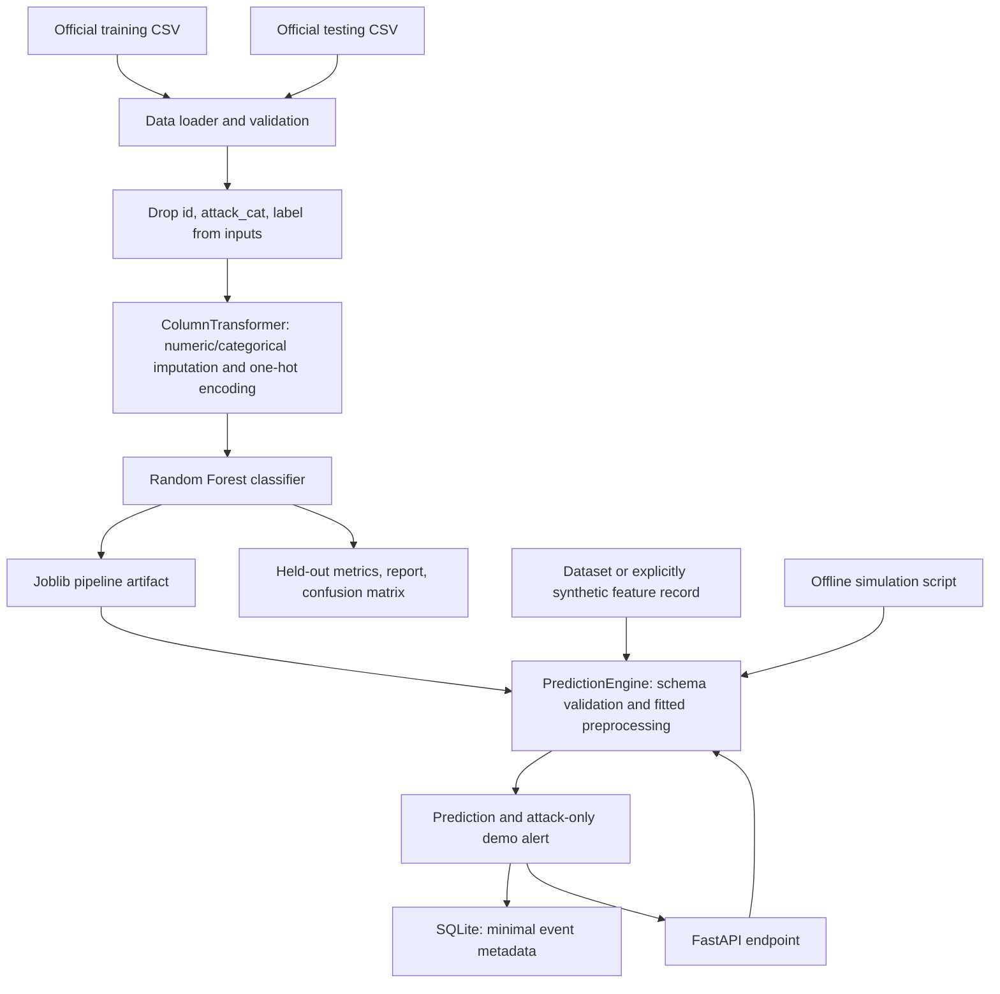

# System architecture

## Implemented data and inference paths

## Responsibilities

- `data/loader.py`: file existence/read errors, binary-target and schema checks, split loading, feature/label separation, and quality summaries.
- `ml/train.py`: lazy imports for scikit-learn, training-only imputation/encoding, deterministic Random Forest configuration, one-time official test evaluation, and persistence. The fitted pipeline owns preprocessing so inference cannot refit on test/inference data.
- `ml/predict.py`: local model load, exact feature-name validation, single/batch predictions, and class score extraction. Unknown categories are delegated to the fitted encoder's `handle_unknown="ignore"` setting.
- `detection/alerts.py`: separate rule; predicted attacks produce a demo alert. Confidence at least 0.8 is called `high`, otherwise `medium`. That threshold is illustrative and uncalibrated.
- `database/repository.py`: standard-library SQLite tables; stores source and scores plus a feature count, not feature values/raw payloads.
- `simulation/demo.py`: selects real Normal, DoS, and Reconnaissance examples if present and constructs marked synthetic high-count/rate changes from a Normal row. There is no authentication-failure field, so no brute-force detector is implemented.
- `api/main.py`: root/health/model status, single/batch inference, and persisted detection history. Inference returns 503 when there is no loadable artifact; malformed features return 422.
- `visualization.py`: actual label/category charts and a held-out confusion matrix, generated only from actual data/model outputs.

## API process flow

`POST /predict` and `POST /predict/batch` validate request structure with Pydantic, load/cache the local model pipeline, validate the model's exact feature schema, predict, evaluate the documented alert condition, persist minimal event metadata, and return validated responses. `GET /health` means the service process is healthy; `model_ready` separately reflects whether a model loads. `/docs` is FastAPI's generated Swagger UI. The API does not collect live traffic.

## Persistence and privacy

`outputs/detections.sqlite3` is created on first event. Each row has event/alert IDs, timestamp, predicted class, scores, severity, method, source type, and feature-count summary. The repository deliberately does not store the actual input dictionary. Database artifacts are ignored by Git.

## Not implemented

There is no unsupervised anomaly detector, packet/flow ingestion service, capture capability, real-time stream, production authentication/authorization, calibrated confidence, production SOC escalation, or deployment configuration. Synthetic scenarios are examples, not attack emulation.
